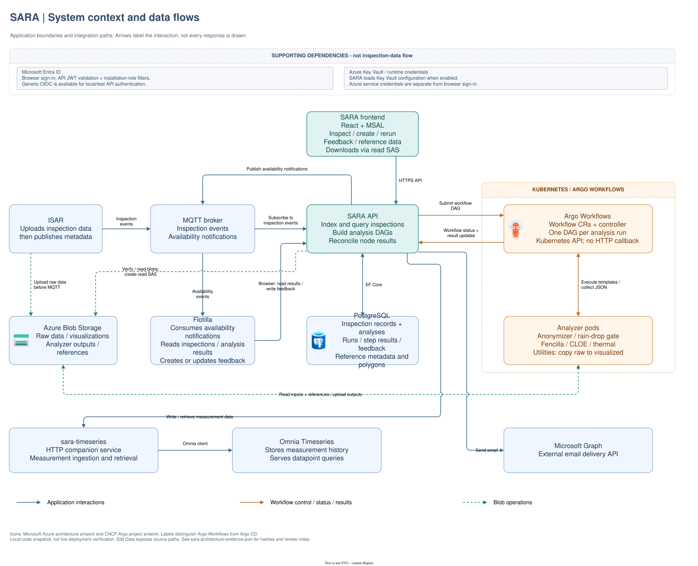

# SARA architecture diagrams

Code-grounded architecture views of SARA, maintained as native [draw.io](https://www.drawio.com/) files. Each element carries the source files it was derived from, and [sara-architecture-evidence.json](sara-architecture-evidence.json) records the commits, file hashes and design decisions behind the current revision.

| View | Question it answers | Source | Preview |
|---|---|---|---|
| System context | Which systems does SARA talk to, over what, and in which direction? | [diagrams/sara-architecture-system.drawio](diagrams/sara-architecture-system.drawio) | [svg](images/sara-architecture-system.svg) |
| Internal components | How are MQTT ingestion, HTTP controllers, record/trigger services, Argo submission and result handling wired inside `api/`? | [diagrams/sara-architecture-components.drawio](diagrams/sara-architecture-components.drawio) | [svg](images/sara-architecture-components.svg) |
| Runtime lifecycle | What happens, in order, from ISAR upload to Flotilla seeing a result? (Main success path only.) | [diagrams/sara-architecture-runtime.drawio](diagrams/sara-architecture-runtime.drawio) | [svg](images/sara-architecture-runtime.svg) |
| Runtime – alternate paths | Where does the flow branch away from the main path: other entry points (value messages, HTTP create/add-analysis, rerun/retry), grouped analyses and deferral, gate steps and grouped readiness? | [diagrams/sara-architecture-runtime-alternates.drawio](diagrams/sara-architecture-runtime-alternates.drawio) | [svg](images/sara-architecture-runtime-alternates.svg) |
| Runtime – failure handling | When something goes wrong, where is it detected, what state is left in SARA, how is it logged and what happens next? | [diagrams/sara-architecture-runtime-failures.drawio](diagrams/sara-architecture-runtime-failures.drawio) | [svg](images/sara-architecture-runtime-failures.svg) |
| Roles and access | Who may call what, and how is installation scoping enforced? | [diagrams/sara-architecture-access.drawio](diagrams/sara-architecture-access.drawio) | [svg](images/sara-architecture-access.svg) |



## Layout

```
docs/architecture/
├── README.md                        this file, including the maintenance guide
├── sara-architecture-evidence.json  provenance: commits, file hashes, element → source map, standing design decisions
├── diagrams/                        editable .drawio sources (single source of truth)
└── images/                          derived SVG exports, never edited by hand
```

## Viewing and editing

- Open any `diagrams/*.drawio` in the draw.io desktop app or VS Code draw.io extension.
- Select an element and choose **Edit Data** (Ctrl/Cmd+M) to see the `source` paths the claim is based on.
- Source paths in diagrams and the evidence file are relative to the [equinor/robotics](https://github.com/equinor/robotics) workspace root, so this repository appears as `sara/...` and cross-repo references (`flotilla/...`, `isar/...`, `robotics-infrastructure/...`) resolve alongside it.

## Scope and caveats

- The diagrams describe the checked-in code and configuration at the commits listed under `repositories` in the evidence file, not a verified live deployment.
- The runtime lifecycle view shows the main success path only (new, valid inspection with an analysis selected and any required group complete). The alternate-paths view covers the other entry points and decision branches on the success side (duplicates, value messages, HTTP create/add-analysis, rerun/retry, grouped analyses, gate steps). The failure-handling view lists each SARA-side failure path as a table row; retries inside Argo and MQTT broker QoS are outside SARA and not shown, and alerting rules (Grafana, Teams) are operated outside this repository.
- The add-analysis entry point (A4) is drawn as intended and flagged with a warning note: the current code re-triggers every non-grouped analysis on the record instead of only the named one, see [equinor/sara#636](https://github.com/equinor/sara/issues/636).
- Known simplifications and open review questions are listed under `scope_limits_and_review_questions` in the evidence file.

## Maintaining the diagrams

This section applies to agents and humans alike.

### Principles

1. **Code is the authority.** Every box, arrow and label must be traceable to source files. If the code and the diagram disagree, the diagram is wrong.
2. **`diagrams/*.drawio` is the single source of truth.** `images/` is derived output; never edit the SVGs by hand.
3. **Patch, do not regenerate.** Keep stable element IDs and existing geometry. Reviewers and manual edits depend on them.
4. **Record provenance.** Every element that asserts a fact about the system has `source` (newline-separated workspace-relative paths) and `evidence` attributes in its `<object>` wrapper. Keep `sara-architecture-evidence.json` in sync.
5. **One question per diagram.** When a view becomes hard to read, split it into another view (for example main path, alternate paths, failure handling) rather than dropping SARA behaviour. Scope is a reason to add a diagram, never to omit what SARA does. Other systems' internals are out of scope; show only their interface with SARA.

### When to update

- A change in any of the files listed under `files` in the evidence file (compare `sha256` with the working copy; a changed hash is a review prompt, not proof the diagram is wrong).
- New or removed external integrations, MQTT topics, controllers, result handlers, hosted services or authorization policies.
- Changes to the analysis trigger/group logic or Argo submission and reconciliation.

### Update workflow

1. **Read the code first.** Verify the exact behaviour (direction, trigger condition, ordering) in the source before touching XML. Do not infer from names.
2. **Read the current `.drawio` before editing.** Humans edit these files in draw.io between agent turns; always start from the file on disk. Note that draw.io may serialise newlines in attributes as `&#xa;` or `&#10;`; grep for both before patching.
3. **Edit the native XML surgically.** Change labels, `source`/`evidence` attributes, geometry or styles on existing cells. Add new cells with descriptive kebab-case IDs. Remove cells together with any children (edge labels use `parent="<edgeId>"`).
4. **Update the evidence file.** Keep `elements.<view>.<id>` in sync with the diagram and refresh `files` hashes and `repositories` heads if claims were re-verified. `decisions` describes the *current* design, one entry per standing choice with the `view` it applies to: amend the entry a change affects, add one for a genuinely new choice, and delete entries that no longer hold. It is not a changelog; git history is.
5. **Validate.** IDs must be unique and every `source`, `target` and `parent` must resolve. A minimal check:

   ```bash
   python3 - <<'EOF'
   import xml.etree.ElementTree as ET, glob
   for f in glob.glob('docs/architecture/diagrams/*.drawio'):
       r = ET.parse(f).getroot()
       ids = [e.get('id') for e in r.iter() if e.get('id')]
       assert len(ids) == len(set(ids)), f'duplicate ids in {f}'
       refs = {e.get(a) for e in r.iter() for a in ('source', 'target', 'parent') if e.get(a) and '/' not in e.get(a)}
       assert refs <= set(ids), f'dangling refs in {f}: {refs - set(ids)}'
   print('ok')
   EOF
   ```

6. **Re-export previews** (sequentially, one file at a time) and look at the result. The `.drawio` XML has no renderer that reproduces layout, fonts and embedded icons other than draw.io itself, so exporting needs some packaging of draw.io. Any of these work; the output is identical:

   - **Docker, no local install** (preferred for reproducibility):

     ```bash
     docker run --rm -v "$PWD/docs/architecture":/data rlespinasse/drawio-desktop-headless \
       --export --format svg --theme light --embed-svg-images --embed-svg-fonts false --scale 1 --border 25 --timeout 60 \
       --output /data/images/sara-architecture-system.svg /data/diagrams/sara-architecture-system.drawio
     ```

   - **draw.io desktop CLI**:

     ```bash
     DRAWIO=/Applications/draw.io.app/Contents/MacOS/draw.io   # or `drawio` on Linux/Windows
     for v in system components runtime runtime-alternates runtime-failures access; do
       $DRAWIO --export --format svg --theme light --embed-svg-images --embed-svg-fonts false --scale 1 --border 25 --timeout 60 \
         --output docs/architecture/images/sara-architecture-$v.svg docs/architecture/diagrams/sara-architecture-$v.drawio
     done
     ```

   - **VS Code draw.io extension**: open the file and use *Export as SVG* with the same settings (light theme, embed images, no embedded fonts, border 25).

   The same headless image is available as the GitHub Action `rlespinasse/drawio-export-action`, which could regenerate `images/` in CI or fail the build when a committed SVG is stale.

7. **Review the SVG visually** for overlapping labels, arrows that lost their anchors and icons that failed to embed before handing over.

### Conventions

- **Paths** are relative to the `equinor/robotics` workspace root: this repo is `sara/...`, peers are `flotilla/...`, `isar/...`, `robotics-infrastructure/...`, `sara-*/...`.
- **Colours** (all views): blue `#41688B` application messages / API calls; orange `#B76A26` Argo execution, status and results; teal `#14847B` Blob Storage reads and uploads. Neutral text colours `#173653` / `#334E68` / `#52667A`; font Helvetica.
- **Edge labels** are child cells with `style="edgeLabel;..."` and relative geometry plus an `offset` point. Use `labelBackgroundColor=none` unless the label sits on top of another line. Multiline labels in the components view are centre-aligned.
- **Runtime lifecycle view** is a sequence diagram built from invisible lifeline vertices (`*-lifeline`, height 1125 starting at y=225). Arrows attach with `exitY`/`entryY` fractions and `exitPerimeter=0;entryPerimeter=0`; step *k* sits at fraction `(50 + 65·(k−1)) / 1125`. Renumber labels and fractions together when inserting or removing a step.
- **Runtime alternate-paths view** is a flowchart in three lane sections (entry points, trigger, execute). Decision diamonds sit on a column spine at 0.25 of the box width; yes/no edge labels use `labelBackgroundColor=#F8FAFC` (the lane colour) and are offset off the line. Known deviations from intended behaviour use the amber warning style and must reference an issue.
- **Runtime failure-handling view** is a table built from plain cells (`<id>-fail`, `-where`, `-state`, `-told`, `-next`) with stage bands `band-<n>`. Rows are 58 px high with a 6 px gap; insert a row by shifting everything below it. The "What happens" cell colour encodes the log level (red Error, amber Warning, blue Information, grey no log line); keep the legend in sync.
- **Icons** (PostgreSQL, Blob Storage, Argo) are embedded as data URIs; their origin and licence notes live under `assets` in the evidence file. Do not add environment URLs, credentials, subscription or tenant IDs to any diagram.
- **Naming**: file names `sara-architecture-<view>.drawio`; element IDs kebab-case and descriptive (`publish-result`, `flotilla-lifeline`), never numeric.

### Review checklist

- [ ] Each changed claim was verified in the referenced source file, including direction and trigger condition.
- [ ] `source` attributes and `elements` in the evidence file match the diagram.
- [ ] `decisions` still describes the current design (amended, added or removed as needed); no stale entries left behind.
- [ ] ID/reference validation passes.
- [ ] SVG re-exported from the edited `.drawio`; icons still embedded; no overlapping labels.
- [ ] No other system's internals were added to a SARA view.
